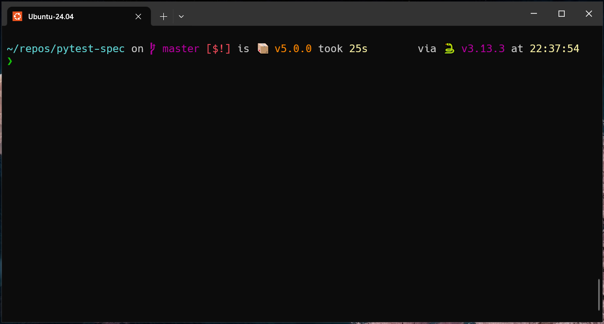
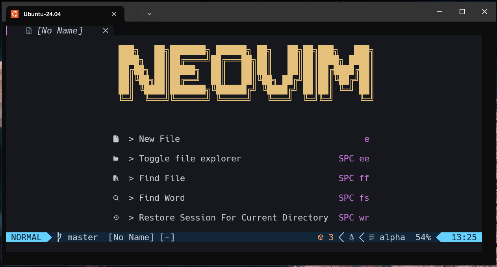
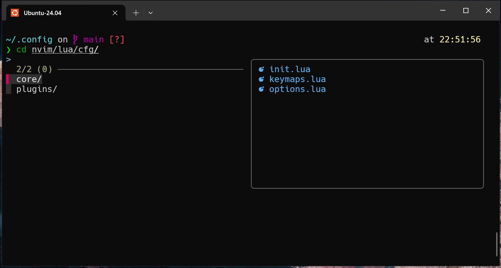
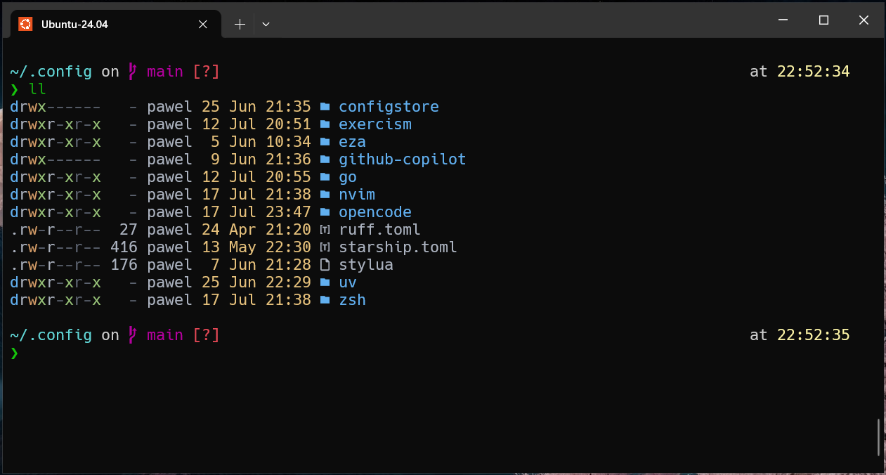

# Dotfiles: Your Personalized Development Environment

Welcome to my personal collection of dotfiles! This repository is designed to help you set up a consistent and powerful development environment across multiple machines. With a single command, you can have your favorite tools configured and ready to go.

## Features

-   **Consistent Configuration:** Keep your settings for `zsh`, `neovim`, `tmux`, and more in one place.
-   **Easy Installation:** A simple setup process to get you up and running quickly.
-   **Customizable:** Easily extend and modify the configurations to fit your needs.

## Requirements

Before you begin, make sure you have the following tools installed:

-   `stow`: For managing symlinks.
-   `zsh`: A powerful and customizable shell.
-   `git`: For version control.
-   `neovim`: The best text editor!
-   `curl`: For downloading files and scripts.

## Included Tools and Configurations

This repository includes configurations for a variety of tools to enhance your terminal and development experience.

### Shell Enhancements

-   **Starship:** A minimal, blazing-fast, and infinitely customizable prompt for any shell.
-   **FZF:** A command-line fuzzy finder for quickly searching and locating files.
-   **Eza:** A modern replacement for `ls` with more features and better defaults.
-   **Bat:** A `cat` clone with syntax highlighting and Git integration.
-   **Zoxide:** A smarter `cd` command that learns your habits.
-   **TLDR:** Collaborative cheatsheets for console commands.
-   **Btop:** A resource monitor that displays usage and stats for processor, memory, disks, network and processes.

Most CLI tools above are automatically installed and managed by [mise](https://mise.jdx.dev/) on first shell startup.

### Development Tools

-   **Tmux:** A terminal multiplexer for managing multiple terminal sessions.
-   **Git:** A distributed version control system.
-   **Mise:** A polyglot tool version manager and task runner that installs most of the CLI tools in this dotfiles setup, including Node.js.
-   **Pyenv:** Python Version Management for switching between multiple Python versions.

### Editor Configuration

-   **Neovim:** A highly extensible, Vim-based text editor. The configuration includes a wide range of plugins to enhance functionality:
    -   **LSP:** Language Server Protocol support for intelligent code completion and diagnostics.
    -   **Auto-session:** A session manager for Neovim.
    -   **Autopairs:** Inserts or deletes brackets, parens, quotes in pair.
    -   **Colorizer:** A plugin for visualizing colors in your code.
    -   **Colorschema:** A collection of colorschemes.
    -   **Dressing:** A plugin to improve the default UI of Neovim.
    -   **Formatting:** A plugin for formatting your code.
    -   **Linting:** A plugin for linting your code.
    -   **Lualine:** A fast and lightweight statusline.
    -   **Mason:** A portable package manager for LSP servers, DAP servers, linters, and formatters.
    -   **Noice:** A plugin for enhanced UI (cmdline, popupmenu, messages).
    -   **Cmp:** A completion engine for Neovim.
    -   **Tree:** A file explorer tree.
    -   **Snacks:** A collection of small, quality-of-life plugins.
    -   **Surround:** A plugin for adding/changing/deleting surroundings of text.
    -   **Telescope:** A highly extendable fuzzy finder over lists.
    -   **Todo-comments:** A plugin for highlighting and searching TODO comments.
    -   **Treesitter:** A parser generator tool and an incremental parsing library.
    -   **Trouble:** A pretty list for showing diagnostics, references, and more.
    -   **Vim-tmux-navigator:** A plugin for seamless navigation between Neovim and tmux splits.
    -   **Which-key:** A plugin to display a popup with possible keybindings.

## Examples

Here are some screenshots showcasing the configured tools in action.

<details>
<summary>Zsh Prompt (Starship)</summary>

</details>

<details>
<summary>Neovim Editor</summary>

</details>

<details>
<summary>Fuzzy Finder (FZF)</summary>

</details>

<details>
<summary>Modern `ls` (Eza)</summary>

</details>

## Installation Steps

### 1. Install Dependencies

First, let's get all the necessary packages installed on your system.

```shell
sudo apt update && sudo apt install -y stow zsh git neovim tmux tree curl kitty
```

Then install `mise`:

```shell
sudo add-apt-repository -y ppa:jdxcode/mise
sudo apt update
sudo apt install -y mise
```

### 2. Install `neovim`

If the version from step 1 is not recent enough, you can install the latest version from the unstable PPA:

```shell
sudo add-apt-repository ppa:neovim-ppa/unstable -y
sudo apt update
sudo apt install make gcc ripgrep unzip git xclip neovim
```

### 3. Install Vicinae

Install the Vicinae application launcher locally:

```shell
curl -fsSL https://vicinae.com/install | bash -s -- --prefix ~/.local
```

Enable the background service so Vicinae starts automatically:

```shell
systemctl --user enable vicinae.service
systemctl --user start vicinae.service
```

### 4. Apply Configuration

Now, let's apply the dotfiles configuration.

```shell
cd dotfiles
stow  -t ~/ -d bin .
stow  -t ~/ -d eza .
stow  -t ~/ -d fontconfig .
stow  -t ~/ -d git .
stow  -t ~/ -d kde .
stow  -t ~/ -d kitty .
stow  -t ~/ -d mise .
stow  -t ~/ -d nvim .
stow  -t ~/ -d starship .
stow  -t ~/ -d tmux .
stow  -t ~/ -d vicinae .
stow  -t ~/ -d zsh .
```

**Note:** If `stow` reports an error, it might be because a file that needs to be symlinked already exists in your home directory. In this case, you should **backup** the existing file(s) and then run the `stow` command again.

After stowing, optionally rebuild the font cache for any custom fonts to be recognized:

```shell
fc-cache -fv
```

### 5. Configure `git`

Create a `.gitcustom.inc` file to store your personal `git` information.

```shell
touch ~/.gitcustom.inc
```

Then, add the following content to the file:

```
[user]
name = Your Name
email = your.email@gmail.com
```

### 6. Change Your Shell to `zsh`

Finally, let's make `zsh` your default shell.

```shell
chsh -s $(which zsh)
```

If `chsh` reports an error or the shell does not change after re-logging in, the shell path might not be in `/etc/shells`. In that case, use this alternative:

```shell
sudo usermod --shell $(which zsh) $USER
```

Verify the change in the system database:

```shell
getent passwd $USER
```

Then **log out completely** (end your desktop/session, not just close the terminal) and log back in. To confirm the new session is using `zsh`:

```shell
echo $SHELL
```

If you want to switch to `zsh` immediately without logging out, run:

```shell
exec zsh
```

**Note:** On the first launch of `zsh`, [mise](https://mise.jdx.dev/) will automatically install all configured tools (including Node.js, Starship, FZF, and others). This may take a few minutes.

<br>

---

<br>

<div align="center">Enjoy your beautifully configured and efficient terminal!</div>
